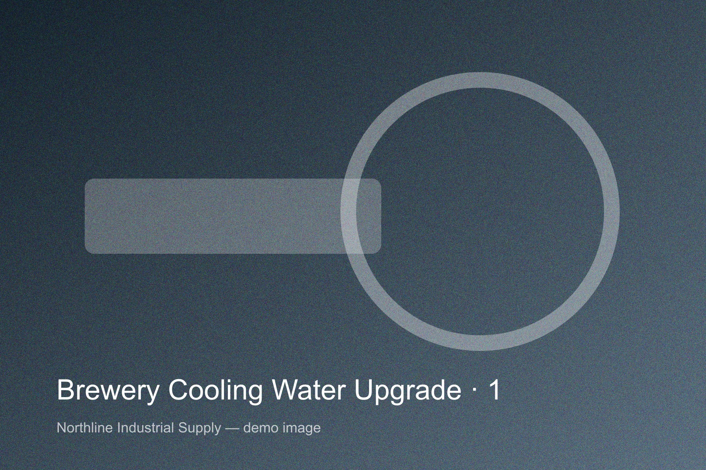
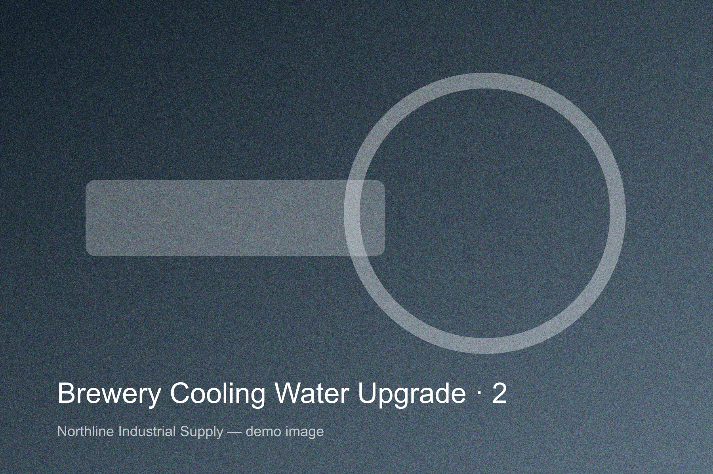
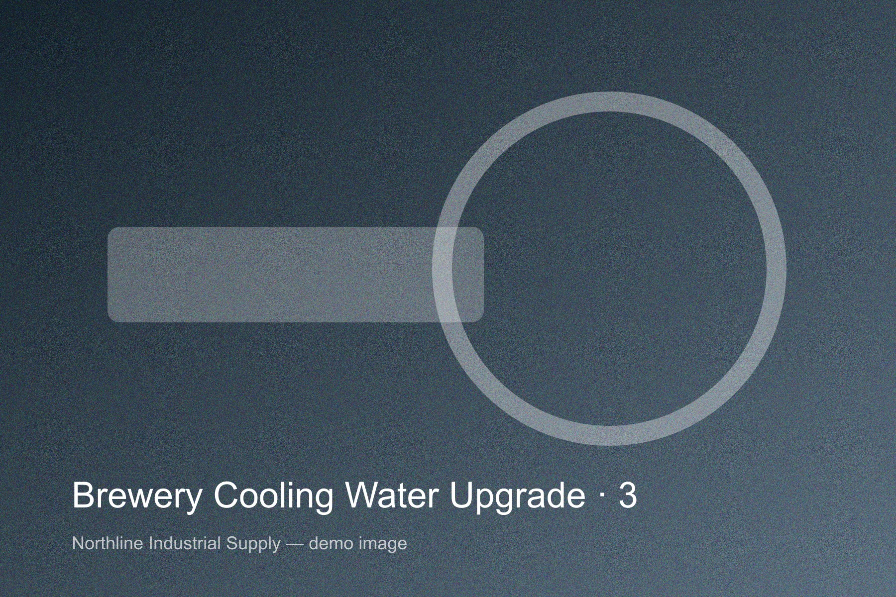

The brewery’s glycol and cooling-water pumps were oversized and ran on throttled valves. We replaced them with two IP-80 inline pumps on variable speed drives.

**Result:** 41% lower pump energy in the first quarter and quieter cellar.

